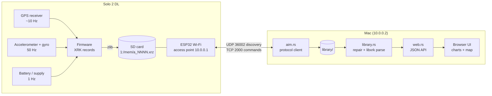
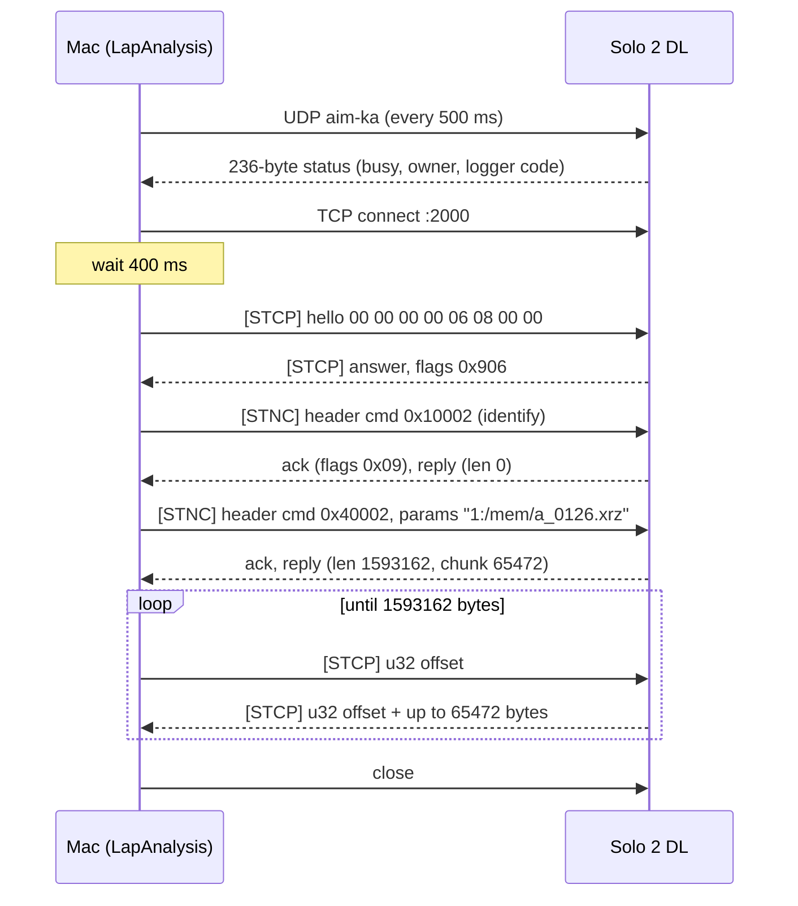

# How LapAnalysis works

There are two halves:

1. **Talking to the logger.** The Solo 2 DL runs its own Wi-Fi network. LapAnalysis finds
   it, opens a session, asks what's been recorded, and downloads the files.
2. **Reading the signals.** Each download is a compressed stream of timestamped sensor
   records: GPS fixes, accelerometer and gyro samples, lap markers. LapAnalysis decodes
   them into channels, laps and a track map.

The protocol was worked out by studying how RaceStudio 3 talks to the logger, then
confirmed packet by packet against a real Solo 2 DL. Its hardware info reports
`WiFi=ESP32|Reg=usa|Rev=02`. Fields still marked *unknown* haven't been needed yet.



---

## 1. The Wi-Fi link

When Wi-Fi is on, the Solo acts as an access point. It hands out addresses over DHCP: the
Solo is **10.0.0.1** and the Mac gets **10.0.0.2/24**, with no gateway, which is why the Mac
has no internet while connected. The radio is an Espressif ESP32 module.

Two ports are used, and nothing else listens:

| Port | Protocol | Purpose |
|---|---|---|
| 36002 | UDP | Discovery and keep-alive (`aim-ka`) |
| 2000 | TCP | Command sessions: listing and downloading |

The Solo never broadcasts on its own. Everything starts with the computer.

### 1.1 Discovery: `aim-ka`

The computer sends the 6 ASCII bytes `aim-ka` from UDP port 36002 to `10.0.0.1:36002`
(LapAnalysis also sends to the broadcast address) about every 500 ms. The Solo answers each
one with a 236-byte status packet:

| Offset | Size | Meaning |
|---|---|---|
| `0x00` | u32 | Packet length, always `0xEC` (236) |
| `0x04` | u32 | Version, `2` |
| `0x08` | 4 | Logger's IPv4 address (`0a 00 00 01`) |
| `0x0e` | u8 | Bit 0 = **busy** (a TCP session is open) |
| `0x11` | u8 | Last octet of the host that owns the session (`2` = the Mac, `0` = none) |
| `0x54` | 4 | `69 64 6e 01` ("idn" marker) |
| `0x5c` | u32 | Logger code: **510** on this Solo |
| others | | *unknown*; mostly zero |

LapAnalysis keeps this exchange running in a background thread, the way RaceStudio does.
That's what drives the "Solo · 10.0.0.1" indicator in the header, and how the app finds
the logger's address without configuration. To stay quiet on your home network, it only
transmits while the UI is open or a download is running.

The busy/owner fields are useful for debugging. They flip to `busy=1 owner=.2` within
about half a second of a TCP connect and clear about 0.5 s after the close. If the Solo claims a
session nobody holds, RaceStudio sends it `aim-kb 02 <host octet> 01` to reset it.
LapAnalysis hasn't needed that.

### 1.2 Opening a session (TCP 2000)

1. Connect to `10.0.0.1:2000`.
2. **Wait 400 ms.** A hello sent immediately after connecting is silently ignored.
3. Send the hello and wait up to 750 ms for its answer. If none comes, resend it, up to 5
   tries. LapAnalysis then retries once more with slower timing.
4. Send the **identify** command (`0x10002`). RaceStudio sends it first in every session.

The Solo's screen shows **"PC connection"** while a session is open.

### 1.3 Framing

Everything on the TCP connection is wrapped in the same frame:

```
offset  0     2      6          10   11   12           12+n  13+n   17+n    19+n
        +-----+------+----------+----+----+-- ... --+-----+------+-------+-----+
        | '<h'| tag  | len: u32 | 00 | '>'|  data   | '<' | tag  | sum16 | '>' |
        +-----+------+----------+----+----+-- ... --+-----+------+-------+-----+
          2B    4B      4B LE    1B   1B     n B      1B    4B     2B LE   1B
```

- **tag** is 4 ASCII bytes. The computer tags command headers `STNC` and everything else it
  sends `STCP` (the hello, data requests). Everything the Solo sends is tagged `STCP`.
- **sum16** is the sum of the data bytes, modulo 65536.
- This is exactly the record format of the XRK files themselves (section 2.2), where the
  `00` byte is a record version. AiM reused its file framing for the network protocol.

The hello is always framed:

```
3c 68 53 54 43 50 08 00 00 00 00 3e | 00 00 00 00 06 08 00 00 | 3c 53 54 43 50 0e 00 3e
 <  h  S  T  C  P  len=8      00 >  |       hello data        |  <  S  T  C  P sum=14 >
```

The answer carries 8 bytes. The high 32 bits are flags:

| Bit | Meaning | Solo's answer `0x906` |
|---|---|---|
| `0x400` | Session refused | no |
| `0x200` | Password required (send it, expect `goSh`) | no |
| `0x100` | Keep framing for the rest of the session | **yes** |
| `0x800`, low bits | *unknown* | `0x800`, `0x6` |

If `0x100` were clear, everything after the hello would be sent unframed. The Solo always
sets it.

### 1.4 Commands

A command is a 64-byte header, sent framed with tag `STNC`:

| Offset | Size | Request | Ack / reply from the Solo |
|---|---|---|---|
| `0x00` | 8 | zero | zero |
| `0x08` | u32 | **Command ID** | same ID echoed |
| `0x10` | u32 | Payload length (0 for everything LapAnalysis sends) | **Reply data length** |
| `0x14` | u32 | 0 | **Chunk size**: 65472 on the Solo |
| `0x18` | u8 | Flags: bit 0 = reply wanted | Ack `0x09`, reply `0x11`; `0x20` = busy, `0x04` = invalid command |
| `0x19` | u8 | 0 | `0x0a` (*unknown*) |
| `0x20` | 32 | **Inline parameters**, e.g. a file path | echoed |

An exchange is: request header → **ack** header → **reply** header → data, if the reply
length is non-zero. The data isn't pushed. The computer pulls it in chunks:



The protocol also has a burst mode, with up to 30 chunks per offset request. The Solo's
hello answer doesn't enable it, so LapAnalysis pulls one chunk at a time. That gives about
**74 KB/s**, so a 1.6 MB session takes around 22 seconds.

### 1.5 Commands LapAnalysis uses

| ID | Inline parameter | Returns |
|---|---|---|
| `0x10002` | — | Identify. Nothing; sent first in every session |
| `0x10008` | — | Hardware info: `WiFi=ESP32\|Reg=usa\|Rev=02\|` |
| `0x20024` | — | **Recorded sessions**, as CSV (section 1.6) |
| `0x40140` | `,recorded` | Folder info: `gpt` header, then the path `1:/mem` |
| `0x40002` | `1:/mem/<name>` | **The file's bytes** |

The rest of the command set (about 90 IDs) covers live data, configuration, firmware and
calibration. LapAnalysis only reads. 🔴 Never send `0x40003`/`0x40004` (a batch file
operation that looks like delete), `0x6xxxx` (configuration and firmware writes) or
`0x8xxxx` (sensor calibration). `0x20005` (media status) isn't supported on the Solo.

### 1.6 The session list

`0x20024` returns CSV with CRLF line endings. Some column names are Italian:

| Column | Meaning |
|---|---|
| `name`, `size` | File name (`a_0126.xrz`) and size in bytes |
| `date`, `hour` | Recording start, `dd/mm/yyyy` and `hh:mm:ss` |
| `nlap`, `nbest`, `best` | Lap count (including the out-lap), best lap number, best lap in ms |
| `pilota`, `veicolo`, `campionato` | Driver, vehicle, championship (empty unless set on the logger) |
| `track_name`, `track_lat`, `track_lon` | Track, and its position in degrees × 10⁷ |
| `motivolap` | Why recording stopped: `stop`, or `mark` |
| `test_dur` | Session length in ms |
| `venue_type`, `mode`, `trk_type`, `maxvel`, `device`, `ptype`, `ptime`, `pdist`, `pmaxv` | Mostly empty or *unknown* |

LapAnalysis stores each row in `library/index.json` when it downloads the file, so the
library can show track and date without opening every session. The details you add on the
session page (name, driver, car, track, tyres, notes) go in the same entry, and they win over
what the logger recorded. The file on disk keeps its logger name; downloads from the UI get
a readable one, like `2026-09-07 Grand Bend - Practice 2 (a_0124).xrz`.

---

## 2. Reading the signals

### 2.1 From sensors to a file

While recording, the Solo samples its sensors and writes timestamped records to the SD card
as `1:/mem/a_NNNN.xrz`. The `.xrz` file is a zlib stream (it starts `78 01`) wrapping an
**XRK** stream. The 1.6 MB `a_0126.xrz` inflates to 3.4 MB of XRK.

LapAnalysis decodes XRK with [libxrk](https://github.com/m3rlin45/libxrk) (MIT), a pure-Rust
reader for AiM's format. The rest of this section describes what's in the stream. Where it
says "on the Solo", the figures come from `a_0126.xrz`, an 18-minute, 12-lap session at
Grand Bend.

### 2.2 Records

An XRK stream is a flat sequence of two kinds of record.

**Header records** use the same frame as the network protocol (`<h TAG len ver > payload
< TAG sum16 >`). They carry configuration, metadata, laps and GPS:

| Tag | On the Solo | Contents |
|---|---|---|
| `CNF` | 1 | Container for the configuration, including one **`CHS`** per channel |
| `GPS` | 9,878 | One GPS fix (section 2.4) |
| `GNFI` | 214 | Logger internal-clock reference, used to sanity-check GPS timing |
| `LAP` | 12 | Lap number, end time and duration |
| `TRK` | 1 | Track name and start/finish line coordinates |
| `RCR`, `VEH`, `CMP`, `VTY`, `NDV`, `SRC`, `RACM`, `TMD`, `TMT` | 1 each | Driver, vehicle, championship, device and session metadata |

**Data records** are compact samples in parentheses. Timecodes are in milliseconds since
the logger powered on:

| Record | Layout | On the Solo |
|---|---|---|
| `(S` | `(S` timecode:i32 channel:u16 value `)` | 131,542: one sample |
| `(M` | `(M` timecode:i32 channel:u16 count:u16 values… `)` | 32,220: a burst of `count` consecutive samples, one per sample period |
| `(G`, `(c` | group / expansion-device data | not used by the Solo |

### 2.3 Channels on the Solo 2 DL

Each `CHS` record names a channel and says how to decode it: the decoder type gives the
sample's width and encoding, plus the sample period and unit. On the Solo:

| Channel | Rate | Encoding | Unit | What it measures |
|---|---|---|---|---|
| InlineAcc, LateralAcc, VerticalAcc | 50 Hz | float16 | g | Built-in accelerometer: braking/acceleration, cornering, bumps |
| RollRate, PitchRate, YawRate | 50 Hz | float16 | deg/s | Built-in gyroscope |
| Internal Battery, External Voltage | 1 Hz | float16 (mV → V) | V | Supply voltages |
| Distance Lap, Distance Lap Int | 10 Hz | float32 | — | Distance into the current lap |
| Master Clk | 10 Hz | int32 | ms | Logger clock |
| Lap Time, Roll Time, Best Time | per event | int32 | ms | Timing events |
| Predictive Time, Best Run/Today Diff | 1 Hz | int32 | ms | Live lap-delta displays |

Float16 is IEEE half precision, AiM's usual encoding for analog sensors. The six 50 Hz
motion channels are written as `(M` bursts of 10 samples (5,370 bursts each in `a_0126`).

### 2.4 GPS

Each `GPS` record is a 4-byte timecode plus a 52-byte **u-blox NAV-SOL** solution: position
and velocity in Earth-centred (ECEF) coordinates, in centimetres, plus fix type, satellite
count and accuracy estimates. libxrk converts these to:

- **latitude / longitude / altitude**, from ECEF using the Vermeille (2003) closed form;
- **speed** = |velocity| in m/s (LapAnalysis shows km/h);
- satellites, fix, pDOP and position/velocity accuracy.

The Solo writes about 10 fixes a second; `a_0126` averages 9.2 Hz over the session.

### 2.5 Time and laps

Timecodes count from logger power-on, so libxrk shifts them to session time. Each `LAP`
record gives a lap's end time and duration, so its start is end minus duration. The first
lap is the **out-lap**, and later ones are full laps. The last one can be an in-lap.
LapAnalysis treats the fastest full lap as the best. That matches the logger's own `best`
column: `a_0126` 1:14.796, `a_0124` 1:11.216.

### 2.6 The firmware's debug-log quirk

The Solo's firmware sometimes writes **its own debug log into the session file** it's
recording. Its log even reports it: `vMemoXdrFile [398]: SD log error`. Lines look like:

```
39789 I: PreBuff Size: 0x00002bd1
40041 I: Start Memo: 1:/MEM/A_0124.XRZ
38766 I: LAP: n.1  1:42.419
83856 N: IOE: 0x02
```

The format is a 5-character millisecond counter, a one- or two-letter level, `: `, text,
then CRLF. In `a_0124.xrz` there are 106 such lines (3 KB) in 55 places, including before the
zlib header, which made the file unreadable. The lines are *inserted* rather than
overwriting data. Removing them restores a zlib stream whose checksum passes, so the repair
is lossless. Occasionally a "session" is nothing but the log (`a_0123.xrz`, 0 laps).

LapAnalysis strips these lines whenever it reads a file. The file on disk stays exactly as
downloaded, and the session page marks it "Repaired" and shows what was removed.

---

## 3. Inside LapAnalysis

| File | Role |
|---|---|
| `app/src/aim.rs` | Protocol client: keep-alive thread, framing, sessions, commands, CSV parsing |
| `app/src/library.rs` | `library/` folder: atomic saves + `index.json`, debug-log repair, libxrk parsing (cached), chart and map data |
| `app/src/best.rs` | Theoretical best lap: corner detection and the fastest time through each corner |
| `app/src/compare.rs` | Lap comparison: distance alignment, time delta, channels resampled onto one grid |
| `app/src/info.rs` | Your session details (name, driver, car, track, tyres and pressures, notes) and their validation |
| `app/src/web.rs` | axum server: JSON API, background download job, embedded assets |
| `app/src/fake.rs` | A fake Solo implementing the logger side of the protocol, for tests and UI work |
| `app/static/` | The UI: plain JS, uPlot for charts (vendored so it works offline) |

**Downloading:** keep-alive finds the Solo → `Session::open` (connect, wait, hello,
identify) → `0x20024` for the list → `0x40002` per file, with progress → the file is
written as `.part`, renamed into `library/`, and its CSV row is added to `index.json`. Sizes
are checked against the list.

**Displaying:** `library.rs` repairs and parses a file once, then caches it. The session
page asks the API for one channel at a time over a time window (a lap, or the whole
session). The server downsamples to roughly the chart's pixel width, keeping each
bucket's minimum and maximum so spikes survive. Charts share one x-range, so the hover
cursor lines up across channels sampled at different rates. The map is the GPS track,
projected flat (longitude scaled by cos(latitude)) and coloured by speed, with a marker
following the cursor.

**Comparing laps:** each lap's distance comes from integrating GPS speed between its start
and finish, with fixes pinned to both ends so the finish lands exactly on the lap time. Every
lap is scaled to the reference lap's length, so a slightly longer line doesn't shift the
corners, then sampled at the same 1,200 distances. At each one, the lap's elapsed time minus
the reference's is the time gained or lost there, and channels are read at that moment. Laps
from other sessions are offered when their first GPS fix is within 3 km of the reference's.

**Theoretical best:** only full laps count (no out- or in-laps), from the sessions you tick,
which can mix cars and drivers at the same track. Laps whose GPS distance is more than 5% off
the median are dropped as bad GPS or a cut track. On the fastest lap's speed trace, smoothed
over ~15 m, every minimum that stands out by at least 6 km/h is a corner, and minima closer
than 80 m count as one. Sections run between the fastest points separating two corners, the
first from the start/finish line, so they're numbered T1, T2… from the line, not by the
track's official turn numbers. Each lap is timed through each section (lined up by distance,
as in Compare), and the fastest times are added up. Speed carried across the line from the
previous lap counts toward T1, so a good exit from the last corner shows up there.

| Endpoint | Returns |
|---|---|
| `GET /api/device` | Logger status from the keep-alive |
| `GET /api/device/sessions` | The logger's session list, marked with what's already downloaded |
| `POST /api/device/download` `{names}` / `GET` | Start a download job / poll its progress |
| `GET /api/library` | Downloaded sessions |
| `GET /api/library/{name}` | Session detail: laps, channels, metadata, your details, repair info |
| `PUT /api/library/{name}/info` `{info, fill_day}` | Save your details; `fill_day` copies driver/car/track to that day's sessions that have none |
| `GET /api/library/{name}/series?id=&lap=&points=` | One channel, downsampled |
| `GET /api/library/{name}/track?lap=&points=` | GPS track with speed |
| `GET /api/library/{name}/raw` | The file as downloaded |
| `GET /api/theoretical?sessions=…` | Theoretical best over the full laps of those sessions (the first decides the track) |
| `GET /api/laps` | Every session with GPS, its laps and first GPS fix, for picking laps to compare |
| `GET /api/compare?laps=file:lap,…&channels=…&points=` | Laps lined up by distance: time delta to the first (reference) lap, channels, racing lines |

---

## 4. Still unknown

- Most of the 236-byte keep-alive packet.
- Hello flag `0x800` and its low bits; header byte `0x19` (`0x0a`).
- Burst mode, which would make downloads faster but needs the logger to advertise it.
- The password handshake's 4-byte prefix (the Solo doesn't ask for one).
- The CSV's `maxvel`, `ptype`…`pmaxv` columns.
